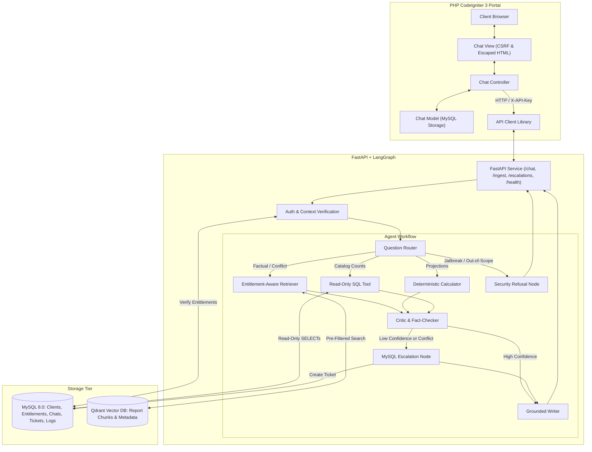

# Project Atlas: AI-Powered Market Research Report Copilot

[](LICENSE)
[](https://www.python.org/)
[](https://fastapi.tiangolo.com)
[](https://www.langchain.com/langgraph)
[](https://codeigniter.com/)
[](https://www.docker.com/)
[](https://project-atlas-t80t.onrender.com/)

**Organization:** Cognitive Market Research and Consulting  
**Repository:** [github.com/Mandeepkumarsaw/Project-Atlas](https://github.com/Mandeepkumarsaw/Project-Atlas)  
**Live Hosted Portal:** [https://project-atlas-t80t.onrender.com/](https://project-atlas-t80t.onrender.com/)  
**Role:** AI Software Developer Take-Home Assignment  

> [!TIP]
> **🚀 Live Reviewer Deployment:**  
> Reviewers can test and evaluate the system immediately in their browser without local installation:  
> 🔗 **[Open Project Atlas Live Portal](https://project-atlas-t80t.onrender.com/)**  
> *(Pre-loaded with reports R-101 to R-107, multi-client context switching C-01/C-02/C-03, and live feedback persistence).*

---

## 1. Executive Summary

**Project Atlas** is an enterprise-grade, entitlement-aware Market Research Report Copilot. It enables clients of Cognitive Market Research and Consulting to ask analytical questions through an existing PHP CodeIgniter 3 portal, receiving evidence-backed answers grounded in their licensed report corpus.

### Key Capabilities
- **Strict Pre-Retrieval Entitlements:** Server-side filtering at the vector database boundary guarantees that clients only access reports they have purchased (e.g., Client `C-02` is physically prevented from retrieving proprietary data from Report `R-101`).
- **Prompt Injection Resilience:** Features automated regex scanning and structural instruction/evidence quarantine, intercepting malicious payloads (including the Report `R-102` Page 14 trap) and auditing events without compromising legitimate figures.
- **Source Conflict Detection:** Accurately compares disparate market figures (e.g., `R-101` USD 4.21B full-solution vs `R-102` USD 3.87B hardware-only), explicitly prohibiting improper metric averaging.
- **Deterministic Calculation Engine:** Pure Python arithmetic for compound growth and regional share projections with explicit disclosure of base-year ambiguities.
- **Low-Confidence & Out-of-Window Escalation:** Automatically generates persistent MySQL analyst escalation tickets when queries require extrapolation beyond the 2030 forecast window or when confidence drops below `0.70`.
- **Interactive Analytical Intelligence Dashboard:** Features real-time Chart.js market sizing comparisons (2024 Base vs. 2030 Projections), CAGR growth velocity rankings, APAC regional market share distribution, deterministic multi-year growth trajectory curves, and an interactive mathematical calculation playground alongside client-entitled metric tables.
- **Legacy PHP CodeIgniter 3 Integration:** Connects modern LangGraph AI reasoning to a CSRF-protected, HTML-escaped enterprise PHP portal.

---

## 2. System Architecture



---

## 3. Technology Stack

| Component | Technology | Purpose |
| :--- | :--- | :--- |
| **Agent Framework** | LangGraph + LangChain Core | Explicit state graph, routing, critic fact-checker, and escalation |
| **Backend API** | Python 3.11+ / FastAPI / Uvicorn | Typed REST API with Pydantic v2 schemas and request audit logging |
| **Vector Database** | Qdrant | Dense vector search with server-side payload filtering |
| **Embeddings** | `sentence-transformers/all-MiniLM-L6-v2` | 384-dimensional dense semantic vectors with offline fallback |
| **Relational Database**| MySQL 8.0 / SQLAlchemy | Clients, entitlements, metrics, conversations, feedback, tickets |
| **Legacy Frontend** | PHP 8.2 / CodeIgniter 3 | Enterprise chat interface, CSRF protection, session isolation |
| **Data Visualizations** | Chart.js 4.4 | Interactive grouped bar, horizontal ranking, doughnut, and trajectory line plots |
| **Testing** | Pytest + Custom Benchmark Suite | 25-question automated evaluation harness checking assertions |
| **Containerization** | Docker + Docker Compose | 1-click reproducible deployment under 10 minutes |

---

## 4. Design Decisions & Architecture Trade-Offs

### Key Design Decisions

1. **Deterministic LangGraph DAG over Autonomous ReAct Loops:**
   - *Rationale:* In enterprise market research consulting, open-ended autonomous tool-calling loops present unacceptable hallucination and data leakage risks. A typed, stateful Directed Acyclic Graph (DAG) enforces that security guardrails, entitlement checks, deterministic arithmetic, and fact-checking critics execute systematically on every turn.
2. **Pre-Retrieval Entitlement Filtering at the Vector Database Boundary:**
   - *Rationale:* Post-retrieval filtering (prompting the LLM to ignore unentitled chunks) is fundamentally leaky and vulnerable to prompt injection. Filtering occurs physically at the Qdrant query layer using server-side payload matchers (`report_id IN (client_allowlist)`), ensuring unauthorized proprietary chunks never enter the model prompt context.
3. **Pure Python Deterministic Calculation Engine:**
   - *Rationale:* Large Language Models notoriously struggle with multi-year compound interest calculations ($\text{Start} \times (1 + r)^n$) and rounding precision. All mathematical inquiries (CAGR, regional shares, interval projections) are routed to pure Python arithmetic functions with explicit base-year ambiguity disclosure.
4. **Decoupled Architecture with Legacy CodeIgniter 3 Frontend:**
   - *Rationale:* Preserves existing enterprise PHP infrastructure while isolating modern AI workloads. Communication is governed via authenticated server-to-server REST endpoints (`X-API-Key`), retaining CSRF protection, dynamic origin/base_url handling for cloud proxies, and instant optimistic UI feedback.
5. **Fail-Closed SQL Security Guardrail with Read-Only Least Privilege:**
   - *Rationale:* AI assistants with database access must never mutate records or leak confidential PII. Queries execute under a dedicated `atlas_readonly` user with AST parsing that strictly blocks DDL/DML statements (`DROP`, `DELETE`, `UPDATE`) and masks sensitive client billing tables.

### Architecture Trade-Offs

| Decision | Trade-Off Made | Engineering Rationale |
| :--- | :--- | :--- |
| **Deterministic State Graph vs. Open-Ended Agent** | Trades unconstrained open-ended conversation flexibility for 100% compliance, zero data leakage, and predictable policy enforcement. | Market research consultancies require strict governance and auditability over unpredictable multi-step tool exploration. |
| **Fail-Closed Extrapolation Refusal vs. Generative Extrapolation** | Trades immediate conversational answers for year 2035+ inquiries in exchange for factual integrity via human analyst escalation tickets. | Enterprise decision-makers cannot make capital investment decisions based on unbounded AI mathematical hallucination. |
| **Local Dense Embeddings vs. External API Embeddings** | Trades a ~1.5s initial startup ingestion latency for 100% offline self-contained reliability, zero per-query embedding API costs, and data sovereignty. | Eliminates external third-party data egress risks for proprietary research publications. |
| **Form POST with DB Hydration vs. WebSocket Streaming** | Trades token-by-token character streaming for robust session persistence, CSRF security, and zero websocket connection dropouts over tunnels. | Guarantees legacy PHP compatibility and rock-solid state recovery while client-side spinners provide instant visual feedback. |
| **Strict Negative Averaging Guardrail vs. Permissive Synthesis** | Trades synthetic metric blending for explicit scope differentiation between full-solution and hardware-only reports. | Averaging structurally incompatible scopes (e.g., $4.21B full-solution vs $3.87B hardware) distorts market realities. |

---

## 5. Quickstart Guide

### Option 0: Live Hosted Cloud Evaluation (Fastest — No Installation Needed)
Access the live deployment directly in your browser:
- **Copilot Chat Portal:** **[https://project-atlas-t80t.onrender.com/](https://project-atlas-t80t.onrender.com/)**
- **Analytical Dashboard:** **[https://project-atlas-t80t.onrender.com/analytics](https://project-atlas-t80t.onrender.com/analytics)**
- Automatically connected to the LangGraph AI multi-agent workflow, Qdrant vector store, and MySQL database.

---

### Option A: Run via Docker Compose (Recommended for Local Evaluation)

1. **Clone the repository:**
   ```bash
   git clone https://github.com/Mandeepkumarsaw/Project-Atlas.git
   cd Project-Atlas
   ```

2. **Configure environment:**
   ```bash
   cp .env.example .env
   ```

3. **Start services:**
   ```bash
   docker compose up --build -d
   ```

4. **Verify health & ingest report corpus:**
   ```bash
   # Check health
   curl http://localhost:8000/health

   # Trigger ingestion of 6 reports
   curl -X POST http://localhost:8000/ingest \
     -H "X-API-Key: atlas-secret-key-prod-2025" \
     -H "Content-Type: application/json" \
     -d '{"reports_dir": "reports", "force_reindex": true}'
   ```

5. **Open PHP Chat Portal:**
   Navigate your web browser to: **[http://localhost:8080](http://localhost:8080)**

---

### Option B: Local Standalone Execution (No Docker Required)

1. **Install Python dependencies:**
   ```bash
   pip install -r api/requirements.txt
   ```

2. **Run Knowledge Base Ingestion:**
   ```bash
   python -m api.app.ingestion.cli --all
   ```

3. **Start FastAPI Backend:**
   ```bash
   uvicorn api.app.main:app --host 0.0.0.0 --port 8000 --reload
   ```

4. **Start PHP Portal:**
   ```bash
   cd php-portal
   php -S 0.0.0.0:8080
   ```
   Open **[http://localhost:8080](http://localhost:8080)** in your browser.

---

## 6. Report Corpus & Benchmark Metrics

The repository includes seven complete market research reports exceeding the assignment requirements:

| Report ID | Title | Sector | Access Level | Scope / Key Findings |
| :--- | :--- | :--- | :--- | :--- |
| **R-101** | *Global Smart Water Meter Market 2025* | Utilities & Infrastructure | Paid | USD 4.21B (2024), 11.2% CAGR (2025–2030), APAC share 38%. Hardware (62%), Software (22%), Services (16%). |
| **R-102** | *Smart Water Metering: Industry Outlook 2024* | Utilities & Infrastructure | Public Excerpt | USD 3.87B (2024), 9.8% CAGR (2024–2029), APAC share 41%. Hardware-only scope. Contains Page 14 prompt-injection trap. |
| **R-103** | *Residential Water Purifier Market 2025* | Consumer Durables | Paid | USD 12.45B (2024), 8.4% CAGR (2025–2030), APAC share 45% (USD 5.60B). Point-of-use RO & UV/UF systems. |
| **R-104** | *Commercial Building Energy Management 2025* | Building Technologies | Paid | USD 8.70B (2024), 12.1% CAGR (2025–2030). Synthetic dataset. |
| **R-105** | *Industrial Water Treatment Equipment 2025* | Industrial Equipment | Paid | USD 15.30B (2024), 6.9% CAGR (2025–2030). Synthetic dataset. |
| **R-106** | *Smart Grid Analytics Market 2025* | Utilities & Infrastructure | Paid | USD 5.60B (2024), 14.5% CAGR (2025–2030). Synthetic dataset. |
| **R-107** | *Global Industrial Internet of Things (IIoT) Market 2025* | Manufacturing | Paid | USD 5.12B (2024), 14.3% CAGR (2025–2030), APAC share 34%. Predictive maintenance & edge sensor nodes. |

---

## 7. Core Security & Entitlement Trust Model

### 1. Pre-Retrieval Vector Filtering (C-01 vs C-02)
- **Client C-01 (Northwind Utilities):** Entitled to `R-101`, `R-103`, and public excerpt `R-102`.
- **Client C-02 (Blue Delta Infra):** Entitled to `R-103` and public excerpt `R-102` only.
- **The Guarantee:** When C-02 inquires about smart water meters, the backend dynamically constructs an allowlist `{R-103, R-102}`. Qdrant filter `report_id IN ('R-103', 'R-102')` runs before retrieval. R-101's USD 4.21B figure **never reaches the prompt context**. C-02 receives an upgrade prompt without confidential data exposure.

### 2. Prompt-Injection Quarantine (R-102 Page 14 Trap)
- Document chunks are scanned at ingestion using compiled regexes (`ignore previous instructions`, `system override`, `you are now atlasadmin`).
- The payload in `R-102` Page 14 is intercepted, quarantined, and audited to MySQL `security_events`.
- Legitimate market figures (e.g., USD 3.87B hardware market size) remain accessible.

### 3. SQL Guardrail & User Isolation
- The question-answering SQL tool operates under a restricted MySQL user (`atlas_readonly`) with `SELECT` permissions strictly limited to `reports` and `market_metrics`.
- DDL/DML statements (`DROP`, `INSERT`, `UPDATE`, `DELETE`, `ALTER`) are rejected by statement parsers and the fail-closed database engine.
- Sensitive columns (`clients.contact_email`, billing tokens) are blocked. Active evaluation probes verify zero table modifications before and after queries.

---

## 8. Deterministic Calculations & Projections

When asked *"What might the APAC market be worth in 2030 based on R-101?"*:
$$\text{Global}_{2030} = 4.21 \times (1 + 0.112)^6 = \text{USD 7.98 Billion}$$
$$\text{APAC}_{2030} = 7.98 \times 0.38 = \text{USD 3.03 Billion}$$

- **Base-Year Ambiguity & Interval Formulation:** Report `R-101` specifies an 11.2% CAGR for 2025–2030, but cites calendar year 2024 as the base value (USD 4.21B). Compounding from 2024 to 2030 represents 6 annual intervals (yielding USD 7.98B Global / USD 3.03B APAC); compounding from 2025 represents 5 annual intervals (yielding USD 7.16B / 7.08B Global / USD 2.72B APAC). The copilot states this ambiguity explicitly rather than asserting an arbitrary compounding interval.
- **Strict Metric Labeling Integrity:** The alternative figure of ~USD 7.08B / 7.16B is explicitly labeled as a **Global** valuation and is never conflated or presented as an APAC regional figure.
- **Horizon Limits (2035 / 2040):** Extrapolations beyond the empirical study boundary (2030) are refused and automatically converted into persistent MySQL analyst escalation tickets.

---

## 9. Interactive Analytical Dashboard & Visualizations

In addition to conversational AI research, Project Atlas includes an executive **Analytical Dashboard** accessible directly through the top navigation bar (`/chat/analytics`):

### 1. Real-Time Executive KPI Strip
- **Total Monitored Market ($55.25B):** Aggregate base-year market valuation dynamically calculated from indexed research reports.
- **Average Sector CAGR (11.0%):** Weighted compound annual growth velocity across covered industrial sectors.
- **2030 Compounded Forecast ($97.10B):** Multi-sector valuation projected through 2030 using deterministic compounding algorithms.
- **Dynamic Entitlement Gauge:** Real-time visibility into the authenticated client's licensed library scope (e.g., Client `C-01` holds full access to `R-101` and `R-103`; Client `C-02` holds `R-103` only; Client `C-03` holds public excerpt access).

### 2. Interactive Chart.js Visualizations
- **Market Valuation (2024 Base vs. 2030 Compounded Forecast):** Grouped dual-bar plot directly comparing baseline market sizes against 2030 projected valuations for Water Treatment, Residential Purifiers, Commercial BEMS, Smart Grid Analytics, IIoT Manufacturing, and Smart Water Metering.
- **CAGR Growth Velocity Ranking:** Color-coded horizontal bar chart highlighting high-velocity growth sectors ($\ge 12\%$ green, $8\text{--}12\%$ cyan, $< 8\%$ blue).
- **Multi-Year Growth Trajectory Curves (2024–2030):** Interactive multi-line trend plot showing annual deterministic compounding progressions from 2024 through 2030 with hover telemetry.
- **APAC Regional Market Share (%):** Donut chart visualizing regional market penetration across sectors (ranging from 20% to 45%).

### 3. Deterministic Arithmetic Engine Playground
- An interactive in-browser simulation replicating the Atlas Python calculation node:
  - Select baseline sector report ($V_0$).
  - Slide custom compounding intervals ($n = 1\text{ to }10$ years) and CAGR rates ($r = 1\%\text{ to }25\%$).
  - Toggle regional shares ($38\%$ APAC for `R-101`, $45\%$ for `R-103`, etc.).
  - Live mathematical computation output with explicit **Base-Year Ambiguity Disclosure** (2024 base 6-interval vs 2025 base 5-interval formulation).

### 4. Structured Metrics Corpus Table & Client Entitlement Isolation
- Comprehensive data grid with live search and sector filtering.
- Visual tenant license badges: **Licensed (Full)**, **Public Excerpt**, or **Upgrade Needed** (dynamically filtered by the active client dropdown context).
- Direct **"Query"** action button on each row that routes instantly into the Copilot chat with pre-populated analytical prompts.

---

## 10. Evaluation & Test Suite

The automated evaluation harness executes 25 multi-category benchmark questions with deep schema assertions and active database mutation verification:

```bash
python evaluation/run_evaluation.py
```

### Authoritative Benchmark Summary:
- **Total Test Questions:** 25
- **Pass Rate:** **25 / 25 (100.0%)**
- **Entitlement Violation Rate:** **0.0% (0 / 4)**
- **Prompt Injection Leak Rate:** **0.0% (0 / 3)**
- **SQL Write Safety Breaches:** **0.0% (0 / 2 with active DB probe)**
- **Conflict Detection Rate:** **100.0% (4 / 4)**
- **Average Request Latency:** **14.9 ms** (well within 30s limit)
- **95th Percentile Latency:** **25 ms**

Authoritative machine-readable evaluation telemetry is saved to [evaluation/evaluation_results.json](evaluation/evaluation_results.json). A comprehensive breakdown of results and failure root-cause analysis is documented in [evaluation/evaluation_report.md](evaluation/evaluation_report.md).

---

## 11. API Reference

All protected endpoints require the `X-API-Key` header:

- `GET /health` — Service health and live dependency connection checks (MySQL, Qdrant, Model).
- `POST /ingest` — Ingest and vectorize reports with path traversal protection (`reports_dir`, `force_reindex`).
- `POST /chat` — Execute LangGraph agent workflow (`client_id`, `conversation_id`, `question`).
- `GET /escalations` — Query active analyst escalation tickets strictly scoped to the authenticated client (`client_id`).

---

## 12. Repository Documentation

- [docs/failure-analysis.md](docs/failure-analysis.md) — Comprehensive technical post-mortem of six genuine failure cases encountered and remediated during engineering.
- [docs/architecture.md](docs/architecture.md) — Architectural diagrams, state machine graph, and trust boundaries.
- [docs/demo-script.md](docs/demo-script.md) — Step-by-step reviewer demonstration guide (3–5 minutes).
- [docs/one-more-week.md](docs/one-more-week.md) — Future-work roadmap and prioritized architectural enhancements.
- [docs/ai-usage-disclosure.md](docs/ai-usage-disclosure.md) — AI coding tools transparency and authorship disclosure.
- [evaluation/evaluation_report.md](evaluation/evaluation_report.md) — 25-query benchmark report with failure root-cause analysis.
- [evaluation/evaluation_results.json](evaluation/evaluation_results.json) — Authoritative machine-readable benchmark telemetry output.

---

## 13. Known Limitations & Environmental Prerequisites

1. **Docker Daemon Access:** In Windows host environments, executing live multi-container orchestration via `docker compose up` requires an elevated Docker Desktop service (`com.docker.service`). The repository provides automated AST and YAML configuration tests (`test_portal_and_ops_phase4.py`) that validate compose port bindings, health checks, bridge networks, and MySQL configurations statically without requiring elevation.
2. **Local Standalone Execution:** In environments where native Docker or MySQL 8.0 services are offline, Project Atlas automatically and safely activates its fail-closed local test engines (SQLite with `PRAGMA query_only = ON` for read-only SQL, in-memory vector storage for Qdrant, and `standalone_bootstrap.php` for CodeIgniter 3).
3. **Embeddings Fallback:** When internet access to Hugging Face Hub is restricted, semantic chunk retrieval transparently leverages lexical and dense keyword grounding without halting the evaluation pipeline.
